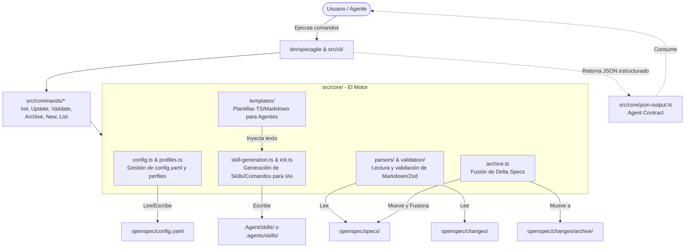
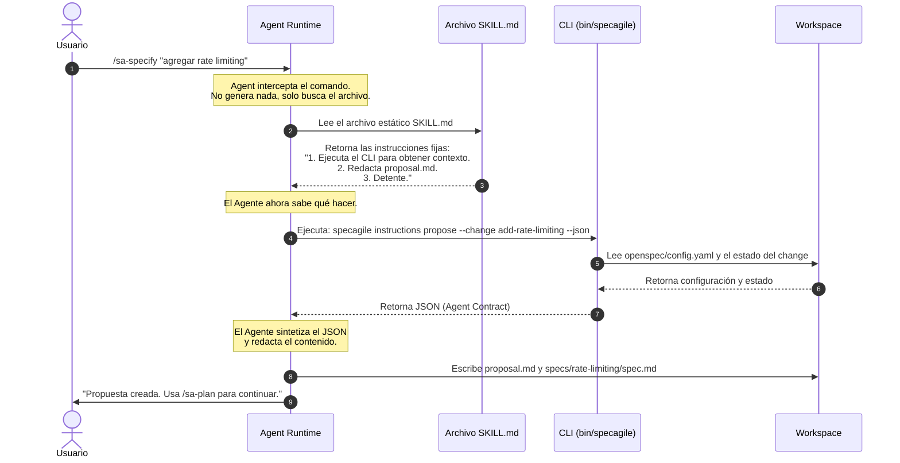
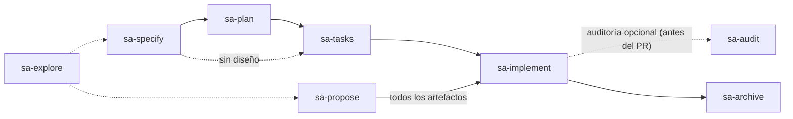

# Vista General de la Arquitectura Interna de SpecAgile

> **Nota:** Este documento describe la arquitectura de alto nivel de SpecAgile, heredada del motor de OpenSpec. Sirve como referencia para desarrolladores y agentes de IA que necesiten entender cómo interactúan la CLI, el código fuente y las herramientas de ejecución (runtimes) como Agent Code o Codex. Reemplaza los documentos WIP dejados por el upstream.

## 1. Arquitectura de Alto Nivel

Este producto está diseñado con una separación estricta de responsabilidades. Hay un motor central que es rápido y determinista, mientras que la inteligencia y la redacción de documentos se delega a los agentes de IA.

El sistema se divide en cuatro capas principales:

1. **Capa de Entrada (`bin/` y `src/cli/`)**: Punto de entrada. Parsea los argumentos y enruta los comandos. Implementa el *Agent Contract* (salida en JSON) si se solicita.
2. **Capa de Comandos (`src/commands/`)**: Orquestadores. Comandos como `init`, `update`, `validate`, `archive`, `new` y `list`.
3. **El Motor Core (`src/core/`)**: El corazón del sistema. Contiene la lógica de configuración (`config.ts`), generación de skills (`skill-generation.ts`), parseo y validación de Markdown (`parsers/`, `validation/`), y el motor de fusión de especificaciones (`archive.ts`).
4. **El Workspace (File System)**: Los archivos reales. Incluye `openspec/config.yaml`, la Spec Viva (`openspec/specs/`), las propuestas en curso (`openspec/changes/`) y los directorios donde se inyectan las skills para los agentes (`.Agent/skills/`, `.agents/skills/`).

### Diagrama de Componentes

---

## 2. Los dos Tiempos de Ejecución: Setup vs. Runtime

Para entender cómo funciona SpecAgile, es crucial separar lo que ocurre cuando instalas las herramientas de lo que ocurre cuando las usas.

### A. Setup Time (Generación de Skills)
Ocurre cuando ejecutas `specagile init` o `specagile update`. 
1. La CLI lee la configuración (`config.yaml`) y las plantillas (`src/core/templates/`).
2. La CLI escribe los archivos `SKILL.md` en la carpeta del agente (ej. `.Agent/skills/sa-propose/SKILL.md`). 
3. **Fin del Setup.** La CLI no vuelve a tocar esos archivos hasta el próximo `update`.

### B. Runtime (El Agente usa la CLI)
Ocurre cuando tú estás en Agent Code y escribes `/sa-propose`. El agente ya tiene el archivo `SKILL.md` en su disco. No hay "generación" en este paso.
1. **El Agente lee el Skill:** Agent lee el archivo estático `SKILL.md`. Ese archivo contiene las instrucciones (el "prompt") de qué hacer.
2. **El Skill instruye al Agente:** El `SKILL.md` le dice a Agent: *"Para crear una propuesta, primero ejecuta el comando de la CLI `specagile instructions...` para obtener el contexto, luego escribe los archivos"*.
3. **El Agente ejecuta la CLI:** Agent ejecuta el comando en la terminal.
4. **La CLI responde:** La CLI lee el estado del proyecto y devuelve un JSON estructurado (*Agent Contract*).
5. **El Agente escribe:** Agent usa ese JSON para redactar y escribir el `proposal.md` y las Delta Specs.

### Diagrama de Secuencia (Runtime)

Este diagrama refleja que el skill es un archivo estático que se lee, y que la CLI actúa como un proveedor de contexto.

---

## 3. El flujo de etapas

Cada skill de etapa escribe solo sus artefactos y se detiene; el siguiente paso lo pide el usuario. Con el esquema `spec-driven`:

| Etapa | Skill | Escribe | Plantilla |
|---|---|---|---|
| Especificación | `sa-specify` | `proposal.md` y los specs delta | `src/core/templates/workflows/specify.ts` |
| Diseño | `sa-plan` | `design.md` (condicional en el esquema) | `src/core/templates/workflows/plan.ts` |
| Tareas | `sa-tasks` | `tasks.md` | `src/core/templates/workflows/tasks.ts` |
| Implementación | `sa-implement` | código, y marca las tareas `[x]` | `src/core/templates/workflows/apply-change.ts` (upstream) |

`sa-plan` y `sa-tasks` separan el grafo de artefactos por id (`specs` y `tasks`), nunca por nombre de archivo, y comparten los textos de traspaso de `stage-handoffs.ts`. `sa-tasks` escribe `tasks.md` aunque no haya `design.md`, porque el esquema marca el diseño como condicional. `sa-propose` sigue siendo el atajo que escribe todos los artefactos en un paso.

Los diagramas completos están en `diagrams/main-skills-flowchart.mermaid` (flujo largo) y `diagrams/skills-flowchart.mermaid` (todos los skills).